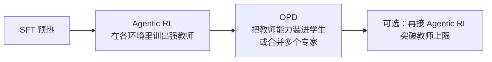

# Agentic RL 与 OPD

常有人问："Agentic RL 是不是就是 OPD？"不是。两者不是同一个维度上的两个选项：

- **Agentic RL 是问题设定**：训练智能体在环境里多轮行动（调工具、看反馈、再行动），目标是把任务做成；
- **OPD 是训练信号**：学生自己生成轨迹，教师逐 token 打分。它可以用在智能体任务上，也可以用在单轮数学题上。

一个回答"**训练什么**"，一个回答"**信号从哪来**"。两者可以组合，但不能互相替代。

## 两个维度交叉，得到四种情况

| | 结果奖励（环境 / 验证器打分） | 教师信号（OPD） |
|---|---|---|
| **单轮任务** | RLVR，比如 DeepSeek-R1 用 GRPO 做数学 | 推理 OPD，比如 Thinking Machines、Qwen3 |
| **多轮智能体** | **Agentic RL 的主流做法**：在 τ²-bench、SWE、搜索等环境里跑多轮 GRPO / PPO | **Agentic OPD**：STRIDE、State-OPD、ATOD、tinker 的多轮工具调用配方 |

平时说"做 Agentic RL"，大多指左下角：用环境给出的结果奖励训练。OPD 进入智能体领域是右下角，属于比较新的方向，见 [Agentic OPD](../frontier/agentic.md)。

## Agentic RL 比单轮 RL 多了什么

| | 单轮任务 | 多轮智能体 |
|---|---|---|
| 一条轨迹里有什么 | 题目 + 模型的一段回答 | 模型的多次输出 + 工具返回 + 用户（或用户模拟器）的发言 |
| 哪些 token 参与训练 | 整段回答 | 只有模型自己写的部分，工具返回和用户发言要用 loss mask 遮掉 |
| 奖励来自哪里 | 判分函数 | 环境：任务有没有完成、最终状态对不对 |
| 主要难点 | 奖励稀疏 | 奖励更稀疏（十几轮、上万 token 只有一个分数）、环境工程、长上下文、rollout 慢 |

一条多轮轨迹的样子（只有标"训练"的部分参与梯度）：

```text
[user]      帮我查明天新加坡的天气                                   ← mask
[assistant] <tool_call>{"name":"get_weather",
              "arguments":{"city":"Singapore","date":"明天"}}</tool_call>    ← 训练
[tool]      {"error":"date 必须是 YYYY-MM-DD 格式"}                   ← mask
[assistant] <tool_call>{"name":"get_weather",
              "arguments":{"city":"Singapore","date":"2026-10-20"}}</tool_call>  ← 训练
[tool]      {"temp":"31°C","weather":"雷阵雨"}                        ← mask
[assistant] 明天新加坡 31°C，有雷阵雨，记得带伞。                      ← 训练
```

## 同一条轨迹，两种信号怎么打分

| | 结果奖励（GRPO） | 教师信号（OPD） |
|---|---|---|
| 这条轨迹 | 任务最终完成，奖励 1，组内归一化后 advantage 约 +0.87 | 教师逐 token 对比 |
| 写错的 `明天` | 也拿 +0.87，**错误一起被奖励** | $r_t \approx -3.4$，被精确压低 |
| 改对后的日期 | +0.87 | 略为正 |
| 最终回答 | +0.87 | 约 0（和教师一致） |
| "一次调对"和"绕路调对" | 拿同样的分，分不清 | 绕路那一步会被扣分 |

结果奖励只知道"成没成"，OPD 知道"哪一步走偏了"。这就是 OPD 对智能体最有吸引力的地方：**它天然提供细粒度的信用分配**。

## 严格来说，OPD 甚至不算 RL

OPD 借用了 RL 的整套机制（学生采样、advantage、策略梯度），在 verl 里也和 GRPO 共用训练器。但它的目标是**逼近教师的分布**，而不是**最大化任务回报**，本质上是模仿学习，更接近 [DAgger](why-opd.md)。

| | Agentic RL（结果奖励） | OPD |
|---|---|---|
| 优化目标 | 把任务做成 | 像教师一样做 |
| 需要什么 | 环境 + 奖励函数 | 环境 + 一个在这个环境里本来就做得好的教师 |
| 能否超越教师 | 能，本来就没有教师 | 基本不能 |
| 能力从哪来 | 自己探索出来 | 从教师那里搬过来 |

## 实际中怎么分工

工业界的后训练流程里，OPD 常常占了原本属于 RL 的位置。比如 DeepSeek-V4 用多教师 OPD 取代了混合 RL 阶段。但它的各个领域专家（教师）本身就是用 GRPO 训出来的。RL 并没有消失，只是分工变了：



- **RL 负责产生能力**：在各个领域、各个环境里，把专家模型训强；
- **OPD 负责搬运和合并能力**：把一个或多个专家的能力装进学生；
- **想超越教师时再接 RL**，或者在 OPD 的 advantage 里叠加结果奖励。

## OPD 管不了的事

把 OPD 用到智能体上，它解决的是信号稀疏和信用分配。下面这些仍然是 Agentic RL 自己的难题：

- 环境搭建：沙箱、工具服务、用户模拟器；
- 多轮 rollout 的效率：每一轮都要等工具执行，环境可能超时；
- 探索：教师没走过的路，OPD 教不了；
- 教师本身：OPD 额外要求先有一个在这个环境里做得好的教师。

在 Agentic RL 里提供稠密信号，OPD 也不是唯一选择，还有过程奖励模型（PRM）、按轮次给奖励、自蒸馏（SDPO）等，见[自蒸馏](../frontier/self-distillation.md)。

## 继续阅读

- 动手跑多轮 GRPO 和 Agentic OPD：[L4 Agentic RL](../tutorial/l4-agentic.md)
- 智能体场景下 OPD 的研究进展：[Agentic OPD](../frontier/agentic.md)
- 为什么 OPD 能补 RL 的缺口：[为什么需要 OPD](why-opd.md)
