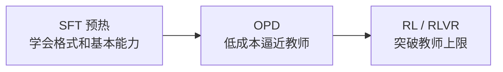

# 为什么需要 OPD

## 一句话

**OPD 让学生自己生成轨迹，教师在学生走到的每个前缀上给出下一个 token 的分布，逐 token 提供反馈。**

- token 由学生采样，所以是 **on-policy**，补上了 SFT 的 exposure bias；
- 反馈来自教师的 logprob，每个 token 都有，所以是**稠密**的，补上了 RL 的稀疏奖励。

## 每个 token 的奖励

标准 OPD（Thinking Machines 版本）中，第 $t$ 个 token 的奖励是：

$$
r_t = \log \pi_T(y_t \mid x, y_{<t}) - \log \pi_S(y_t \mid x, y_{<t})
$$

- $r_t > 0$：教师比学生更认可这个 token → 强化；
- $r_t < 0$：学生比教师更自信 → 压低；
- $r_t \approx 0$：两者看法一致 → 几乎不产生梯度。

$-r_t$ 恰好是逐 token reverse KL 的单样本估计。把 $r_t$ 当作 advantage，丢进现成 RL 框架的策略梯度里，就得到了 OPD。推导见[目标函数与梯度](../theory/objective.md)。

!!! warning "r_t 是相对认可，不是绝对认可"
    教师给某个 token 0.6、学生给 0.9 时，$r_t = \ln(0.6/0.9) \approx -0.41$。即使这是教师心目中最好的 token，也会被压低，因为学生"比教师更自信"。
    
    学生越接近教师，$r_t$ 越趋近 0，信号自然消失。这就是 OPD 的天花板在公式上的体现。

## 用同一道题看三者的差别

学生在"解方程 3x + 5 = 20"上写出了"……得 3x = 25，所以 x = 25/3"。

| 方法 | 这条回答会得到什么反馈 |
|---|---|
| SFT | 不会用到这条回答。SFT 只在标准回答上训练，模型从没见过"3x = 25"这种状态 |
| GRPO | 判错，整条回答的每个 token 都拿到 −0.87，包括前面正确的"两边减 5" |
| OPD | "两边减 5"几乎不变；"25"被重重压低（$r_t \approx -3.4$）；后面的续写信号较弱 |

逐 token 的完整数值表见[三种方法的数据长什么样](data-formats.md)。

## 定位：三者各补一个缺口

| | SFT / off-policy 蒸馏 | RL（GRPO） | OPD |
|---|---|---|---|
| token 是谁写的 | 教师 / 数据集 | 学生 | 学生 |
| 反馈来源 | 标准回答 | 奖励函数 / 验证器 | 教师 logprob |
| 反馈粒度 | 每个 token | 每条轨迹一个分数 | 每个 token |
| 每条轨迹的信息量 | 约 $O(N)$ 比特 | 约 $O(1)$ 比特 | 约 $O(N)$ 比特 |
| 是否 on-policy | 否 | 是 | 是 |
| 能否超过教师 | 不能 | 能 | 基本不能 |
| 需要什么 | 标准回答 | 奖励函数 | 和学生同 tokenizer 的白盒教师 |
| 主要缺口 | exposure bias | 稀疏、信用分配难、贵 | 依赖教师质量与兼容性；长轨迹后段的教师信号会失真 |

所以三者不是并列选项，而是**先后衔接**的阶段：

Qwen3、MiMo-V2-Flash 等模型的后训练都是这个结构的变体，见[工业案例](../cases/index.md)。

## 很像 LLM 版的 DAgger

模仿学习里的 **DAgger**（Ross et al., 2011）这样做：

- 普通的行为克隆只在专家走过的状态上学；
- DAgger 让学生自己开车，开到学生自己会遇到的状态，再问专家"这里该怎么做"。

OPD 和它几乎同构：学生生成前缀，教师在这些前缀上给出下一个 token 的分布。但两者有三处不同，而且第三处恰好是 OPD 最主要的失败来源：

| | DAgger | OPD |
|---|---|---|
| 向专家要什么 | 动作（硬标签） | 完整的概率分布（或其中的 logprob） |
| 数据怎么用 | 把历次数据累积成一个数据集，反复训练 | 通常每一步只用当前策略的新样本 |
| 专家在学生状态上是否可靠 | **假设**专家在任何状态下都能给出好动作 | 不一定。学生的前缀偏得越远（比如陷入重复），教师的分布越不可靠，甚至会认可局部接得上的错误续写 |

所以 OPD 的很多改进（位置加权、漂移检测、动态截断、提前停止），本质上都是在修补"专家并非处处可靠"这个 DAgger 没有的问题。详见[OPD 何时有效、何时失效](../theory/mechanism.md)。

## 为什么省算力

Thinking Machines 在 Qwen3 报告的数据上做了对比 ✅：

| 方法（Qwen3-8B 学生） | AIME'24 | GPQA-Diamond | GPU 小时 |
|---|---|---|---|
| Off-policy 蒸馏 | 55.0 | 55.6 | 未报告 |
| + RL | 67.6 | 61.3 | 17,920 |
| + OPD | **74.4** | **63.3** | **1,800** |

原因有三：

1. **信息量**：每条轨迹约 $O(N)$ 比特，RL 只有约 $O(1)$ 比特；
2. **不需要很多样本**：RL 每题要采 8–16 条才能在组内比较，OPD 每题采 4 条甚至 1 条就有信号；
3. **失败的轨迹照样能学**：不需要同组里有人做对。

## 发展脉络

| 时间 | 事件 |
|---|---|
| 2011 | DAgger：在学生状态上请教专家，奠定理论基础 |
| 2016 | 序列级知识蒸馏（SeqKD，Kim & Rush） |
| 2023-06 | **MiniLLM**（Gu et al.，ICLR 2024）：用策略梯度优化序列级 reverse KL |
| 2023-06 | **GKD**（Agarwal et al.，ICLR 2024）：统一 on-policy 与 off-policy，支持 forward KL、reverse KL、JSD |
| 2024–2025 | DistiLLM、DistiLLM-2 等：探索散度和采样策略 |
| 2025-05 | **Qwen3** 技术报告：小模型用"off-policy 蒸馏 → on-policy 蒸馏"两阶段流程 |
| 2025-10 | **Thinking Machines 博客**：把逐 token reverse KL 当作 advantage 接入 RL 循环，"OPD"这个说法从此流行 |
| 2025-11 | 黑盒 OPD（GAD）：用判别器代替教师 logits |
| 2026-01 | **MiMo-V2-Flash**：多教师 OPD（MOPD）；On-Policy Self-Distillation（OPSD） |
| 2026 | **DeepSeek-V4**：用多教师 OPD 完全取代混合 RL 阶段；NVIDIA Nemotron-Cascade 2 |
| 2026 下半年 | Agentic OPD、Semi-OPD、OPD 综述与研究议程，见[变体与前沿](../frontier/index.md) |

## OPD 的代价和边界

- **上限是教师**：散度最小化本质上是在逼近教师，想超越要再加结果奖励或接 RL；
- **依赖教师质量与兼容性**：教师和学生的思维模式不兼容、教师没有增量能力、尺寸差距太大，都会让 OPD 失败，见[教师怎么选](../practice/teacher.md)；
- **需要白盒教师**：标准 OPD 需要教师在每个位置的 logprob，而且要和学生用同一个 tokenizer。闭源 API 通常做不了，只能用[黑盒变体](../frontier/black-box.md)；
- **要多部署一个教师**：每一步都要让教师在学生轨迹上做一次前向；
- **长轨迹后段不可靠**：学生的前缀越偏，教师信号越失真，见[踩坑大全](../practice/pitfalls.md)。

!!! tip "一句话总结"
    OPD 不是免费午餐，也不是 SFT 或 RL 的替代品。它补的是 SFT 的 exposure bias 和 RL 的稀疏信用分配。默认不要裸用：先 SFT 预热，选兼容且有增量能力的教师，监控前缀漂移，只在教师信号局部可靠的地方学。
