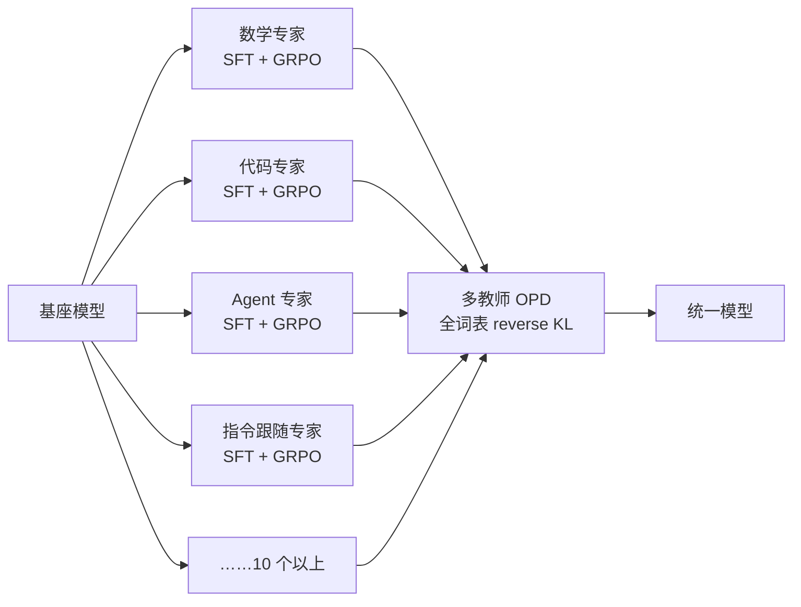

# DeepSeek-V4

**来源**：DeepSeek-V4 技术报告（[arXiv 2606.19348](https://arxiv.org/abs/2606.19348)）第 5.1.2 和 5.2.2 节。✅

## 用 OPD 完全取代混合 RL

DeepSeek-V4 的后训练流程大体沿用 DeepSeek-V3.2，但做了一个关键替换：**原来的混合 RL 阶段被 on-policy 蒸馏整个取代了。**

1. **专家训练**：每个目标领域（数学、代码、Agent、指令跟随等）各自训练一个专家：先在领域数据上 SFT，再用 GRPO 配合领域奖励做 RL；
2. **合并**：用多教师 OPD，让统一模型作为学生，在自己生成的轨迹上向各个专家学习。

## 目标函数

$$
\mathcal{L}_{\text{OPD}}(\theta) = \sum_{i=1}^{N} w_i \cdot \mathrm{KL}\big(\pi_\theta \,\|\, \pi_{E_i}\big)
$$

- $\pi_{E_i}$ 是第 $i$ 个专家，$w_i$ 是它的权重，通常按专家的重要性确定；
- 计算 reverse KL 需要从学生采样轨迹，保证 on-policy；
- 学生会按任务上下文向对应的专家学习：数学题向数学专家对齐，编程题向代码专家对齐；
- 这一阶段用了**10 个以上**的教师。

报告认为，这种在 logits 层面的对齐，避开了传统权重合并和混合 RL 常见的性能下降。

## 为什么用全词表

报告指出，以往的工作通常把全词表 KL 简化成每个位置上的单 token 估计，再把 $\operatorname{sg}[\log(\pi_{E_i}/\pi_\theta)]$ 当作 advantage 复用 RL 框架。这样省资源，但**梯度估计方差大，训练常常不稳定**。

所以 DeepSeek-V4 改用**全词表 logit 蒸馏**：保留完整的 logit 分布来计算 reverse KL，梯度估计更稳定，也更忠实地传递教师的知识。

## 工程实现

支持"数量几乎不受限、单个可达万亿参数"的教师做全词表 OPD：

| 问题 | 做法 |
|---|---|
| 教师太多太大，放不进显存 | 所有教师权重放在集中式分布式存储，前向时用 ZeRO 式参数分片**按需加载** |
| 词表超过 10 万，物化所有教师的 logits 不可行（即使落盘也不行） | 前向时**只缓存最后一层 hidden state**；训练时取出来，过对应教师的输出头，现场重建完整 logits。重算开销可以忽略 |
| 教师输出头占显存 | 数据分发时**按教师编号排序**样本，保证每个 mini-batch 里每个教师的输出头只加载一次，显存里同一时刻最多一个 |
| 加载卸载阻塞计算 | 参数和 hidden state 的加载、卸载全部在后台**异步**进行 |
| KL 计算慢、动态内存分配多 | 用专门的 **TileLang kernel** 精确计算师生 logits 之间的 KL |

配套的基础设施：

- **FP4 量化感知训练**：教师和参考模型也参与，rollout 和推理阶段直接用原生 FP4 权重，保证采样行为和线上部署一致；
- **可抢占、可容错的 rollout 服务**：每个生成请求维护 token 级的预写日志（WAL），被抢占或遇到硬件故障后可以恢复。

## 后续：V4.1-Flash

据 DeepSeek-V4.1-Flash 报告的摘要，最终 OPD 阶段的教师增加到 **40 个以上**，而且每个领域最强的教师可能来自模型开发的不同阶段。⚠️

## 启示

- OPD 已经可以在最前沿的模型上**完全替代**一个 RL 阶段，而不只是给小模型用；
- "先分领域 RL 出专家，再用 OPD 合并"是避免跷跷板问题的一种有效结构；
- 规模上去之后，单 token 估计的方差会成为问题，全词表是更稳的选择，但需要专门的工程投入。
