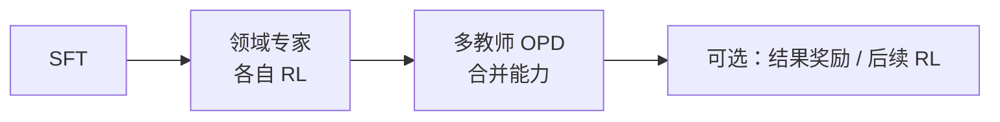

# 工业案例

| 案例 | 机构 | OPD 在流程里的角色 | 亮点 |
|---|---|---|---|
| [Thinking Machines](thinking-machines.md) | Thinking Machines Lab | 推理蒸馏、修复遗忘 | 让 OPD 流行起来的博客；9–30 倍算力节省；用旧模型当教师修复遗忘 |
| [Qwen3](qwen3.md) | 阿里 | 小模型的 Strong-to-Weak 蒸馏第二阶段 | off-policy → on-policy 两阶段；比 RL 少约 10 倍 GPU 小时 |
| [DeepSeek-V4](deepseek-v4.md) | DeepSeek | 取代混合 RL，合并 10 个以上领域专家 | 全词表多教师 OPD；hidden state 缓存等工程设计 |
| [MiMo-V2-Flash](mimo.md) | 小米 | 多教师 OPD（MOPD）+ 结果奖励 | 逐 token 教师信号 + GRPO；公开了学生对比各教师的完整表格 |
| [更多案例](more.md) | NVIDIA、Hugging Face 等 | — | Nemotron-Cascade 2 用中间 checkpoint 当教师；TRL 蒸馏 100B+ 教师；DeepSeek-R1 蒸馏版（off-policy 对照） |

## 共同的模式

- **RL 负责产生能力**：在各个领域、各个环境里把专家模型训强；
- **OPD 负责搬运和合并能力**：把多个专家的能力装进一个模型，同时避免"一项能力涨、另一项能力跌"的跷跷板问题；
- **需要超越教师时，再叠加结果奖励**。
