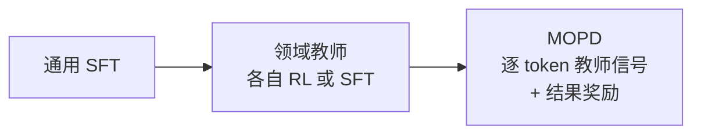

# MiMo-V2-Flash

**来源**：小米，[MiMo-V2-Flash Technical Report](https://arxiv.org/abs/2601.02780)，2026 年 1 月。✅

MiMo-V2-Flash 是 309B 总参数、15B 激活参数的 MoE 模型。它的后训练核心是**多教师 on-policy 蒸馏（Multi-Teacher On-Policy Distillation，MOPD）**，要解决两个问题：

- **能力失衡**：提升一项能力（比如数学）会让其他能力退化，像跷跷板；
- **学习效率低**：没有充分利用多个专家模型的训练信号。

## 三个阶段

教师覆盖：

- **Agent 类**：搜索、代码、通用工具调用；
- **非 Agent 类**：数学、通用推理、安全对齐。

教师可以是 RL 模型、SFT 模型，**也可以是学生自己**。

## 公式

记学生为 $\pi_\theta$，推理引擎的采样策略为 $\mu_\theta$，题目 $x$ 所属领域的教师为 $\pi_{\text{domain}_x}$。

**逐 token advantage：**

$$
\hat{A}_{\text{MOPD},t} = \operatorname{sg}\big[\log \pi_{\text{domain}_x}(y_t) - \log \pi_\theta(y_t)\big]
$$

**叠加结果奖励：**

$$
\hat{A}_{\text{MOPD},t} = \operatorname{sg}\big[\log \pi_{\text{domain}_x}(y_t) - \log \pi_\theta(y_t)\big] + \alpha \cdot \hat{A}_{\text{ORM}}
$$

结果奖励部分默认用 GRPO。报告没有给出 $\alpha$ 的取值。

**训推不一致**：用 $\operatorname{sg}[\pi_\theta / \mu_\theta]$ 做重要性加权，比值落在 $[\epsilon_{\text{low}}, \epsilon_{\text{high}}]$ 之外的 token 直接丢弃。

**基础设施**：推理用 SGLang，训练用 Megatron-LM，两者都用 FP8；MOPD 和 RL 共用一套基础设施（包括 Rollout Routing Replay、数据调度器、基于 Ray 的工具管理）。

## 结果

报告的表 7 对比了 MOPD 前的学生、各领域最强的教师和 MOPD 后的学生（Δ = MOPD 后的学生 − 最强教师）：

| Benchmark | MOPD 前 | 最强教师（类型） | MOPD 后 | Δ |
|---|---|---|---|---|
| AIME 2025 | 89.3 | 93.9（RL） | 94.1 | +0.2 |
| HMMT Feb. 2025 | 76.9 | 82.6（RL） | 84.4 | +1.8 |
| LiveCodeBench | 77.5 | 82.6（RL） | 83.2 | +0.6 |
| MMLU-Pro | 84.7 | 84.7（自己） | 84.9 | +0.2 |
| GPQA-Diamond | 84.9 | 84.9（自己） | 84.3 | −0.6 |
| HLE（无工具） | 21.2 | 21.2（自己） | 22.1 | +0.9 |
| Arena-Hard（Hard） | 50.0 | 50.0（自己） | 54.1 | +4.1 |
| Arena-Hard（Creative） | 90.1 | 90.1（自己） | 86.2 | **−3.9** |
| SWE-Bench Verified | 67.8 | 74.2（RL） | 73.4 | −0.8 |
| Tau2-Bench | 75.9 | 79.6（RL） | 80.3 | +0.7 |
| Tau2-Bench（Telecom） | 92.7 | 95.0（RL） | 95.3 | +0.3 |
| BrowseComp | 42.5 | 51.7（SFT） | 45.4 | **−6.3** |

## 解读

- **大多数领域追平或略超最强教师**：多出来的部分来自叠加的结果奖励；
- **但并非全面胜出**：BrowseComp（长程搜索 Agent）比 SFT 教师低 6.3，Arena-Hard 创意写作低 3.9。长程 Agent 和开放式写作这类能力，较难通过逐 token 模仿完整传递；
- **扩展方便**：新增教师不需要改动流程结构；
- **和其他合并方式相比**：报告认为 MOPD 能保住各教师的峰值能力，而参数合并或顺序训练做不到；
- **共同进化**（作者的展望）：蒸馏后的学生再进入专门的 RL，成为更强的教师，循环往复。报告计划在后续工作中扩大规模，尚未给出结果。

## 启示

- "逐 token 教师信号 + 结果奖励"是突破教师天花板的一种直接做法；
- 多教师合并之后，要逐领域对比最强教师，特别留意长程 Agent 和开放式生成。
