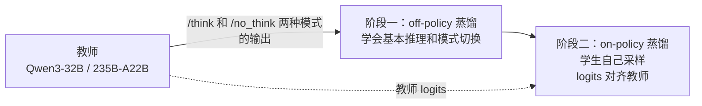

# Qwen3

**来源**：[Qwen3 Technical Report](https://arxiv.org/abs/2505.09388)，2025 年 5 月。✅

## Strong-to-Weak 蒸馏

Qwen3 的旗舰模型走完整的四阶段后训练（长 CoT 冷启动、推理 RL、思考模式融合、通用 RL）。**轻量模型**（0.6B、1.7B、4B、8B、14B 稠密模型和 30B-A3B MoE）不再单独走这四个阶段，而是从旗舰模型蒸馏：

1. **off-policy 阶段**：把教师在 `/think` 和 `/no_think` 两种模式下的输出合在一起做回答蒸馏，让小模型先学会基本的推理能力和模式切换；
2. **on-policy 阶段**：学生对采样的 prompt 用思考或非思考模式自己生成，再把 logits 对齐到教师（Qwen3-32B 或 Qwen3-235B-A22B），最小化 KL。

这个结构正是"SFT 预热 → OPD"的标准配方。

## 效果

报告里用 Qwen3-8B 对比了几种做法：

| 方法 | AIME'24 | GPQA-Diamond | GPU 小时 |
|---|---|---|---|
| Off-policy 蒸馏 | 55.0 | 55.6 | 未报告 |
| + RL | 67.6 | 61.3 | 17,920 |
| + On-policy 蒸馏 | **74.4** | **63.3** | **1,800** |

在 off-policy 蒸馏的基础上，OPD 比 RL 分数更高，GPU 小时只有约十分之一。

## 后续

- Qwen3-VL 的轻量模型沿用了同样的 Strong-to-Weak 蒸馏流程；✅
- 后续研究（"Prefix Teach, Suffix Fade"，2605.13643）指出：强教师教弱学生的场景下，轨迹后段的教师信号会失去区分度（局部可教性塌缩）；只监督信号有效的前缀部分，在 Qwen3 学生上比全轨迹 OPD 更好。⚠️
