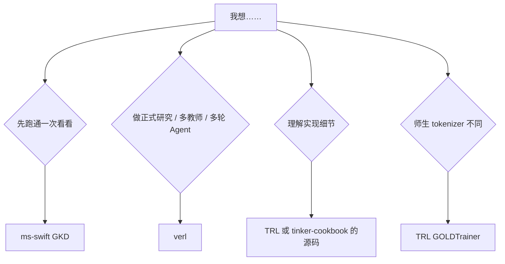

# 框架

| 框架 | 定位 | OPD 支持 | 适合 |
|---|---|---|---|
| [verl](verl.md) | 字节开源的 RL 训练框架，学术界使用最广 | 官方支持单教师和多教师 OPD；PG 和 GKD 两种 loss；独立教师池 | 正式研究、多教师、多模态 |
| [ms-swift](ms-swift.md) | 魔搭的训练框架，中文文档完善 | GKD 训练器，`lmbda=1, beta=1` 就是 Thinking Machines 式 OPD；支持外部 vLLM 教师 | 单机快速跑通 |
| [TRL](trl.md) | Hugging Face 的后训练库 | DistillationTrainer、GKDTrainer、GOLDTrainer（跨 tokenizer） | 读代码理解原理、跨 tokenizer、100B+ 教师 |
| [slime](others.md) | 面向大规模 MoE 的 RL 框架（Megatron + SGLang） | `--use-opd` 等参数，OPD 以加性 KL 惩罚叠加在任意 advantage 上 | 大规模训练 |
| [Tinker / tinker-cookbook](others.md) | Thinking Machines 的托管训练服务和配套示例 | 官方 OPD 配方，含多轮工具调用、多教师 | 读代码；训练要用托管服务，不能在本地 GPU 上跑 |

另外两页：

- [verl 源码走读：一个 OPD step](verl-walkthrough.md)：用一条真实样本，配合交互演示，逐步看数据怎么流动；
- [工程优化](infra.md)：生成缓冲、教师服务、二进制传输、全词表蒸馏的显存技巧。

## 怎么选

!!! warning "版本变化很快"
    这些框架的 OPD 功能都在快速迭代，配置键名经常改变。本站给出的配置截至 2026 年 10 月，以你所装版本的官方文档为准。
