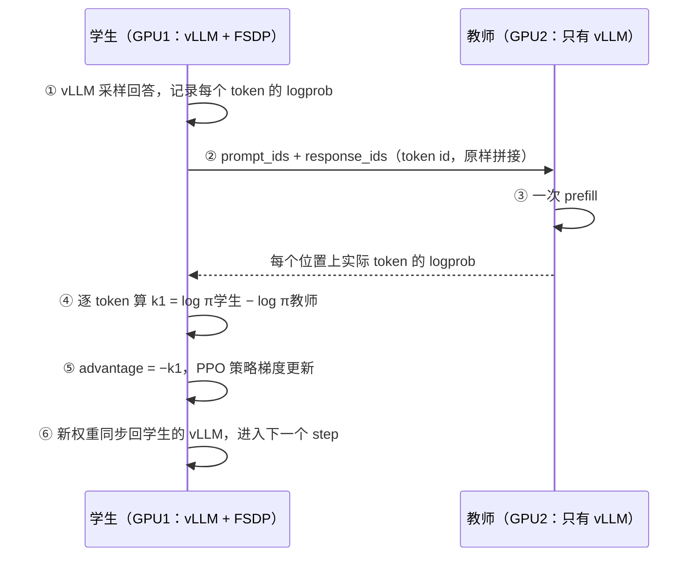

# verl 源码走读：一个 OPD step

这一页用一次真实冒烟测试里抓到的一条样本，一步步看 verl 的 OPD 在一个训练 step 里到底做了什么。

- **学生**：Qwen3.5-4B（关闭 thinking）
- **教师**：27B 模型
- **数据**：GSM8K
- **loss**：k1 + 策略梯度（`use_policy_gradient: true`），`use_task_rewards: false`
- **布局**：学生和教师各占一张卡

## 交互演示

点下方的"播放"，或用"上一步 / 下一步"逐个场景查看。鼠标移到 token 上可以看到单个位置的学生和教师 logprob。

<iframe src="../../demo/opd-step.html" class="demo-frame" loading="lazy" title="verl OPD：一个训练 step"></iframe>

[在新窗口中打开演示](../demo/opd-step.html){ .md-button }

演示由 `opd_explainer/build.py` 从一条 dump 下来的训练样本生成，换样本后可以重新生成。

## 总览：六步



教师只做一件事：给学生的回答"打分"，每个 token 一个 logprob。它不训练，也不生成文本。

## ① 学生采样

prompt 经过 Qwen3.5 的 chat template 后共 93 个 token。因为关闭了 thinking，末尾是一对空的 `<think></think>`。学生生成的回答共 183 个 token：

```text
To find out how many more blocks Jess must walk, let's break down the total distance ...
...
#### 20
```

答案正确，奖励为 1。但本实验 `use_task_rewards=False`，这个奖励**只记录、不参与训练**。

学生在采样时会同时记下每个 token 的 logprob（`rollout_log_probs`）。到这一步，教师还没有参与。

## ② 拼成教师的输入

学生生成完之后，把 prompt 的 token id 和回答的 token id 直接首尾相接，长度 93 + 183 = 276。

两个关键点：

- **拼的是 token id，不是文本。** 不会先解码再重新编码，所以教师看到的 token 和学生生成时一个都不差。这要求两个模型词表相同；
- **不加 system prompt，也不加任何额外说明。** 教师看到的上文就是学生看到的上文，它只需要回答："换成我，在这个位置会给这个 token 多大概率？"

## ③ 请求教师

教师侧并不是通过 HTTP 调用的，而是通过 Ray actor 在进程内直接调用 vLLM 引擎的 `generate`，但只要它在 prefill 时顺带算出的 `prompt_logprobs`：

```python
engine.generate(
    TokensPrompt(prompt_token_ids=[...共 276 个]),
    SamplingParams(max_tokens=1, prompt_logprobs=0),
)
```

- `prompt_logprobs`：让 vLLM 把"输入序列里每个 token 的 logprob"一起返回；
- `max_tokens=1`：vLLM 至少要生成 1 个 token，生成的这个直接丢弃；
- **为什么 `prompt_logprobs=0` 而不是 64？** k1 属于单样本估计（不用 top-K），只需要实际 token 那一个值。代码里大致是 `num_logprobs = topk if use_topk else 0`。`topk=64` 只对 `forward_kl_topk` 这类 loss 生效。

所以教师的工作量就是**一次 prefill**，没有逐 token 的 decode。这也是 27B 教师单卡就够用的原因。

## ③ 对齐：位置 i 预测第 i+1 个 token

模型在位置 $i$ 输出的是对下一个 token 的预测，所以：

$$
\text{teacher\_logprobs}[i] = \log \pi_T(x_{i+1} \mid x_0, \dots, x_i)
$$

- 第 0 个 token 没有上文，vLLM 返回 `None`，verl 把它丢掉，末尾补一个 0 凑齐长度；
- 回答的第 $j$ 个 token 对应下标 $P - 1 + j$（这里 $P = 93$）；
- 训练时只取回答部分的 183 个值，prompt 部分的值算出来但不用。

这是自己实现 OPD 时最容易出错的地方：错一位，整个信号就全乱了。

## ④ 逐 token 对比

每个 token 的 $k_1 = \log \pi_{\text{学生}} - \log \pi_{\text{教师}}$。这条样本的统计：

| 统计量 | 数值 |
|---|---|
| 回答 token 数 | 183 |
| $k_1$ 平均值 | 0.232 |
| $\lvert k_1 \rvert < 0.1$ 的 token | 152 个（83%），两边看法基本一致 |
| $k_1 > 2$ 的 token | 7 个，信号集中在这里 |
| $k_1 > 0$ / $k_1 < 0$ 的 token | 109 / 32 |

$|k_1|$ 最大的几个位置：

| 位置 | 前文 | 学生采样 | 学生概率 | 教师概率 | 教师首选 | $k_1$ |
|---|---|---|---|---|---|---|
| 11 | …more blocks Jess must walk, | ` let` | 0.932 | 0.00014 | ` we` | 8.81 |
| 78 | …Total | ` =` | 0.213 | 0.00012 | ` distance` | 7.48 |
| 138 | Remaining blocks = Total blocks | ` needed` | 0.891 | 0.016 | ` -` | 4.04 |
| 16 | let's break down the | ` total` | 0.989 | 0.020 | ` problem` | 3.92 |

几个观察：

- **信号高度集中**：大部分 token 两边看法一致，梯度主要来自少数几个位置；
- **这条样本里信号最强的位置都是措辞选择**（用 let 还是 we、写 total 还是 problem），而不是算错数字。答案本身是对的，OPD 在把学生的"说话方式"往教师那边拉；
- **正负明显失衡**：$k_1 > 0$（学生比教师更自信，要被压低）的 token 远多于 $k_1 < 0$ 的。这正是 [sampled-token 奖励结构性失衡](../theory/mechanism.md)的一个实例；
- **k1 只看实际采样的那个 token**：教师更喜欢的 ` we`，只能等以后被学生采样到时再被强化。这就是[负反馈之后概率质量流向哪里](../theory/estimators.md)的问题。

## ⑤ k1 怎么变成梯度

```text
k1_j = log πθ(y_j) − log π教师(y_j)     πθ 由 FSDP 重新前向得到，不是 rollout 时记下的值
k1_j 裁剪到 [−10, 10]                   loss_max_clamp=10
A_j  = −k1_j                            detach，当作每个 token 自己的 advantage
L    = PPO-clip(πθ / πold, A_j)，按 token 平均
```

- 训练端拿到教师的 logprob 后，先用 FSDP 重新算一遍学生的 logprob，再逐 token 相减得到 $k_1$；
- **为什么不直接对 $k_1$ 反向传播？** 教师项不含参数，$k_1$ 对参数的梯度就是 $\nabla \log \pi_\theta(y_j)$，它在期望上为 0，没有有用的信号。所以 verl 要求 k1 必须配策略梯度使用，推导见[目标函数与梯度](../theory/objective.md)；
- 把负的 $k_1$ 当作 advantage：学生比教师更自信的 token 被压低，反过来的被抬高；$k_1 \approx 0$ 的 token 几乎不产生梯度。

## ⑥ 更新、同步，进入下一个 step

更新完参数后，新权重同步到学生的 vLLM，下一个 step 用更新后的学生重新采样。**教师永远在给学生当前版本自己写出来的回答打分**，这就是 on-policy。

这次冒烟测试第 5 步的耗时：

| 环节 | 耗时 |
|---|---|
| gen（学生采样 + 教师 prefill） | 6.24 s |
| old_log_prob（FSDP 前向） | 13.59 s |
| update_actor（反向 + 优化器） | 18.69 s |
| update_weights（同步到 vLLM） | 2.23 s |
| **整个 step** | **40.8 s** |

- 教师 prefill 和学生采样是**流式**进行的：一条回答生成完就立刻发给教师，不等整个 batch，所以教师的耗时算在 gen 里；
- 最慢的是 old_log_prob 和 update_actor，原因是参数和优化器都 offload 到了 CPU。

## 涉及的源码位置

下面是这次走读涉及的文件。行号随版本变化，只作为查找的线索：

| 环节 | 文件 |
|---|---|
| 拼接 prompt 和回答 | `agent_loop.py` |
| 通过 Ray 把请求发给教师所在的 GPU | `teacher_manager.py` |
| 进程内调用 vLLM `AsyncLLM` | `vllm_async_server.py` |
| logprob 对齐（位置 $i$ → 第 $i+1$ 个 token） | `vllm_rollout/utils.py` |
| k1、裁剪、策略梯度 loss | `distillation/losses.py` |
