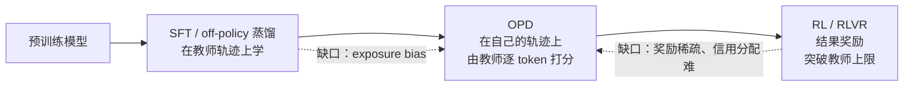

# OPD Wiki

**On-Policy Distillation（在线策略蒸馏，OPD）**：让学生模型在**自己生成的轨迹**上，由教师模型**逐 token** 打分来学习。

它介于 SFT 和强化学习之间：

- 像 RL 一样 on-policy（学生自己采样）；
- 像 SFT 一样信号稠密（每个 token 都有反馈）。

2025 年下半年起，OPD 先后成为 Qwen3、DeepSeek-V4、小米 MiMo-V2-Flash、NVIDIA Nemotron-Cascade 2 等模型后训练流程中的关键一环。

这个 wiki 想把 OPD 的来龙去脉、数学细节、工程实现、踩坑经验和最新进展，用中文系统地整理在一处。

## 一张图看懂 OPD 在哪里

SFT、OPD、RL 不是三选一，而是**先后衔接、各补一个缺口**：

| | SFT（off-policy 蒸馏） | RL（GRPO 等） | OPD |
|---|---|---|---|
| 训练用的 token 是谁写的 | 教师 / 数据集 | 学生 | 学生 |
| 反馈的粒度 | 每个 token | 每条轨迹一个分数 | 每个 token |
| 需要什么 | 标准回答 | 奖励函数 / 验证器 | 教师模型 |
| 能否超过教师 | 不能 | 能 | 基本不能 |
| 主要缺口 | 训练和推理时的前缀分布不一致（exposure bias） | 奖励稀疏，分不清是哪一步错了 | 依赖教师质量与兼容性 |

详细的对比和推导见[为什么需要 OPD](basics/why-opd.md)。

## 怎么读

=== "第一次接触"

    1. [SFT 与 off-policy 蒸馏](basics/sft.md) → [RL 与 GRPO](basics/grpo.md) → [为什么需要 OPD](basics/why-opd.md)
    2. [三种方法的数据长什么样](basics/data-formats.md)：用同一道题对比 SFT、GRPO、OPD 的训练数据
    3. [目标函数与梯度](theory/objective.md)
    4. [FAQ](appendix/faq.md)

=== "想动手跑实验"

    1. [动手教程](tutorial/index.md)：L1 SFT → L2 GRPO → L3 OPD → L4 Agentic RL
    2. [verl](frameworks/verl.md) 或 [ms-swift](frameworks/ms-swift.md) 的配置速查
    3. [verl 源码走读：一个 OPD step](frameworks/verl-walkthrough.md)，带交互演示
    4. [标准配方](practice/recipe.md)、[踩坑大全](practice/pitfalls.md)、[监控与诊断](practice/monitoring.md)

=== "做研究"

    1. [OPD 何时有效、何时失效](theory/mechanism.md)
    2. [估计粒度：sampled-token、top-K、全词表](theory/estimators.md)
    3. [变体与前沿](frontier/index.md)、[开放问题](frontier/open-problems.md)
    4. [参考文献](appendix/references.md)

=== "做工业落地"

    1. [工业案例](cases/index.md)：Thinking Machines、Qwen3、DeepSeek-V4、MiMo-V2-Flash 等
    2. [多教师 OPD](frontier/multi-teacher.md)：把多个领域专家合并成一个模型
    3. [工程优化](frameworks/infra.md)、[算力与硬件规划](practice/compute.md)

## 核心结论速览

- **OPD 补的是两个缺口**：SFT 的 exposure bias，以及 RL 的稀疏奖励。它不能替代 SFT 或 RL。[→](basics/why-opd.md)
- **默认不要裸用 OPD**：先用 SFT 预热，选一个兼容且有增量能力的教师，监控前缀漂移，只在教师信号局部可靠的地方学。[→](practice/recipe.md)
- **教师不是越大越好**：思维模式要兼容，还要有学生没有的能力；差距太大反而学不进去。[→](practice/teacher.md)
- **算力效率高**：Qwen3 报告里，OPD 用 1,800 GPU 小时取得了比 RL（17,920 GPU 小时）更高的分数。[→](cases/qwen3.md)
- **常见失败**：长度暴涨、轨迹后段信号失真、tokenizer 和 EOS 不一致、熵塌缩。[→](practice/pitfalls.md)
- **前沿**：Agentic OPD、自蒸馏、黑盒教师、离线复用学生 rollout（Semi-OPD）。[→](frontier/index.md)

## 内容约定

- ✅ 表示数字或结论已对照一手资料（原论文、官方博客、官方文档）核实；
- ⚠️ 表示来自摘要或二手转述，引用前请回查原文；
- 公式里 $\pi_S$ / $\pi_\theta$ 表示学生，$\pi_T$ 表示教师，$y_t$ 表示第 $t$ 个 token，$y_{<t}$ 表示它之前的前缀。

内容截止到 2026 年 11 月。OPD 发展很快，欢迎通过[关于本站](appendix/about.md)里的方式补充和纠错。
