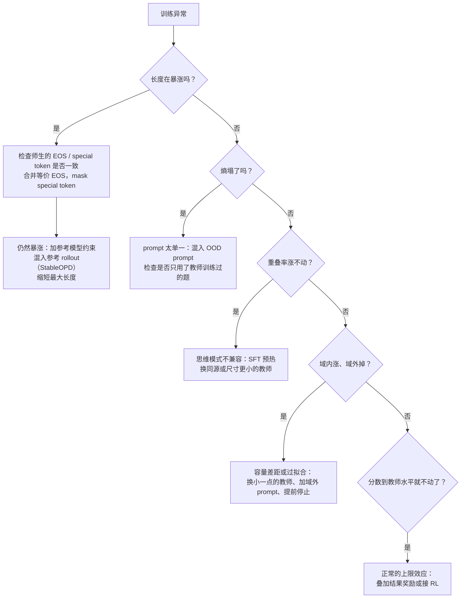

# 监控与诊断

## 必看指标

| 指标 | 含义 | 正常表现 | 异常时说明什么 |
|---|---|---|---|
| 逐 token reverse KL（verl：`actor/distillation/loss`、`abs_loss`） | 学生离教师多远 | 稳步下降 | 不降：教师不兼容或学习率太小。k1 有正有负，看 `abs_loss` 更直观 |
| **师生 top-k 重叠率**（`overlap_ratio`） | 两者高概率 token 的交集比例 | 稳步上升（成功案例从约 72% 升到 91% 以上） | 从一开始就不涨：思维模式不兼容，回去做 SFT 预热或换教师 |
| 交集 token 上的 advantage（`overlap_token_advantage`） | 交集内两者分布的对齐程度 | 趋近 0 | 停滞 |
| `teacher_mass` / `student_mass` | top-k 覆盖了多少概率质量 | 接近 1 | 偏低：k 太小，或者训练已经不稳 |
| 学生熵 | 输出的多样性 | 缓慢下降 | 塌到接近 0：prompt 太单一；飙升：快崩了 |
| **平均长度** | — | 平稳或缓慢变化 | 突然暴涨：长度膨胀，见下文 |
| **截断率** | 达到最大长度被截断的比例 | 很低 | 上升：截断的轨迹开始主导训练数据 |
| 重复率 | 回答里重复片段的比例 | 很低 | 上升：常常和长度暴涨同时出现 |
| KL 随 token 位置的分布 | 轨迹不同位置的师生差距 | 前后差不多 | 后段方差和极端值暴涨：后段信号失真，考虑截断或缩短长度 |
| **域外 benchmark** | 没有训练的能力 | 基本不变 | 下降：容量差距或过拟合教师的某些习惯 |
| 验证集分数 | 目标任务 | 上升 | — |

verl 里，top-k 相关的指标只用于记录，不影响梯度。✅

叠加任务奖励时，对比 `actor/distillation/loss` 和 `actor/pg_loss` 的量级，用来调 `distillation_loss_coef`。

## 开训前的检查

1. **sanity check**：学生和教师设成同一个模型，loss 应该接近 0；
2. **对齐检查**：抽一条样本，确认教师打分时的 token 序列和学生生成时完全一致（同样的 chat template、同样的 special token），第 $i$ 个位置的教师 logprob 对应的是第 $i+1$ 个 token；
3. **重叠率基线**：用初始学生在一小批 prompt 上测一次重叠率；
4. **确认采样来自学生**：比如 ms-swift 在 `lmbda > 0` 却没开 vLLM 时，会悄悄退回 off-policy，直接用数据集里的回答。✅

## 异常排查

## 评测时的注意事项

- 固定评测时的采样参数（温度、top-p、最大长度），并在报告里写明；Thinking Machines 的推理评测用温度 1.0、top_p 1.0、最大 64K token。✅
- 数学类 benchmark 题目少、方差大，用多次采样取平均（如 avg@16、avg@32）；
- 除了目标任务，至少留一个域外 benchmark 和一个指令跟随 benchmark（如 IF-eval）；
- 和 GRPO 等方法对比时，说明控制的是**相同步数**还是**相同 GPU 小时**。OPD 多了教师打分，GRPO 每题要采更多样本，两者的单步成本不一样。
