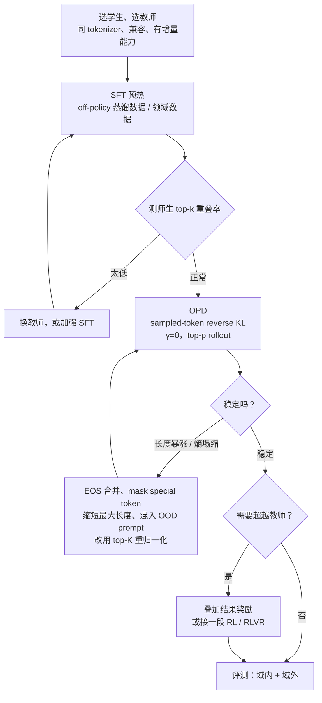
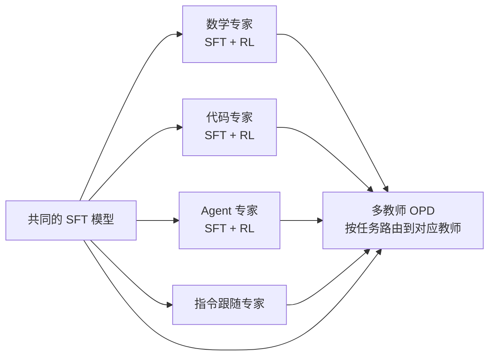

# 标准配方

## 推荐流程

逐步说明：

1. **选教师**：和学生同家族、同 tokenizer；最好经过 RL 或专门训练，有学生没有的能力；尺寸差距适中。见[教师怎么选](teacher.md)。
2. **SFT 预热**：学生连格式正确的轨迹都写不出来时，不要上 OPD。用教师离线生成的数据做一轮 SFT（小模型用长短 CoT 混合）。
3. **开训前测重叠率**：在一小批 prompt 上让学生生成，再让教师打分，计算师生 top-k 的重叠率。成功的实验大约从 70% 起步（Rethinking OPD 的参照值，不是通用门槛）。
4. **OPD**：从最简单的版本起步：sampled-token（k1）+ 策略梯度，折扣因子 0，rollout 用 top-p 0.9，mask special token，合并等价的 EOS，最大长度先设 4K–8K。
5. **prompt**：对齐教师 RL 时用的模板和题目，同时混入一部分 OOD prompt。见[数据与 prompt](data.md)。
6. **监控**：重叠率、逐 token KL、长度、截断率、熵、域外 benchmark。见[监控与诊断](monitoring.md)。
7. **不稳定时**：改用 top-K（K≥32）重归一化的 KL，或加参考模型约束、混入参考 rollout。见[踩坑大全](pitfalls.md)。
8. **想超越教师**：叠加 ORM / GRPO 结果奖励，或者 OPD 之后再接一段 RL。

## 按预算选方案

OPD 综述（2604.00626）的建议 ✅：

| 预算 | 方案 |
|---|---|
| 小（约 500 GPU 小时以内） | 前缀截断、离线缓存教师 logprob（FOPD、Lightning-OPD）；也可以考虑 [Semi-OPD](../frontier/efficiency.md) |
| 中 | 完整 OPD + 自适应散度 |
| 大（约 5000 GPU 小时以上） | off-policy 预热 → on-policy 精修 → 可选的 RL |

## 多领域：先分后合

想让一个模型同时擅长多个领域时，业界的做法是：

- DeepSeek-V4：用 10 个以上领域专家做多教师 OPD，完全取代原先的混合 RL 阶段；
- MiMo-V2-Flash：多教师 OPD 再叠加结果奖励；
- Nemotron-Cascade 2：直接拿级联 RL 过程中各领域最强的**中间 checkpoint** 当教师。

详见[多教师 OPD](../frontier/multi-teacher.md)。

## 修复遗忘

给模型注入新知识（比如公司内部文档）后，指令跟随能力常常会下降。Thinking Machines 的做法 ✅：

1. 在新知识上做中训练（混入约 30% 的对话数据）；
2. 用**原始模型当教师**，在通用 prompt（Tulu3）上做 OPD，不需要内部文档。

IF-eval 从 79% 回到 83%，新知识基本保住。见[Thinking Machines 案例](../cases/thinking-machines.md)。

## 超参参考

下面是公开资料里能找到的设置，只能当起点，不是调好的最优值：

| 来源 | 设置 |
|---|---|
| Thinking Machines ✅ | 每 batch 64 个 prompt × 每题 4 条 = 256 条；折扣因子 0 |
| tinker-cookbook（推理 OPD）✅ | LoRA rank 128，lr 1e-4（LoRA）/ 5e-5（全参），groups_per_batch=512，max_tokens=16384，200 步 |
| tinker-cookbook（多轮工具 OPD）✅ | max_turns=10，group_size=4，groups_per_batch=8，lr 1e-4，LoRA rank 8，max_trajectory_tokens=24576，temperature=1.0 |
| Revisiting OPD（LSM）✅ | batch 128，mini-batch 64，lr 2e-6，教师 top-K=32，rollout top-p 0.9 |
| Rethinking OPD（基于 verl）✅ | lr 1e-6，global batch 64 |
| verl PG OPD 示例 ✅ | `clip_ratio_low: 0.2`，`clip_ratio_high: 0.28` |

!!! note "LoRA 也能用"
    Thinking Machines 发现：rank 32 的 LoRA 在 SFT 后比全参微调差 13%，OPD 后只差 6%。OPD 对 LoRA 比较友好，资源紧张时可以优先考虑。✅

## 一个最小可行实验

| 项目 | 设置 |
|---|---|
| 学生 | Qwen3-1.7B-Base，先用教师数据 SFT |
| 教师 | Qwen3-8B（同家族、同 tokenizer） |
| 数据 | GSM8K 或 DAPO-Math-17k 的题目 |
| 方法 | sampled-token reverse KL，γ=0，每题 4 条，top-p 0.9，最大长度 4K |
| 对照 | 同一个 SFT checkpoint 出发的 GRPO（相同步数或相同 GPU 小时） |
| 观察 | 验证集分数、重叠率、长度、域外能力 |

完整步骤见[动手教程 L3](../tutorial/l3-opd.md)。
