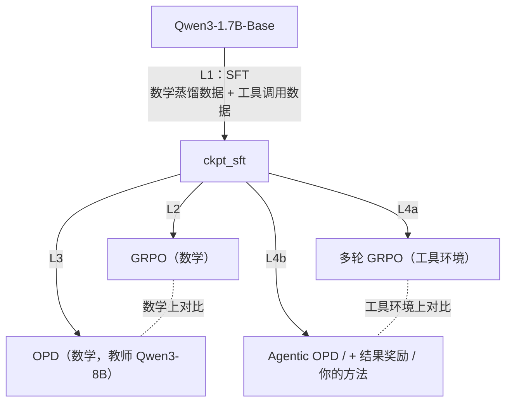

# 动手教程

这套教程按 **SFT → GRPO → OPD → Agentic RL** 的顺序，带你从零跑通 OPD，最后进入多轮智能体任务。每个阶段都有数据样例、命令、最小实验、监控指标和过关标准。

## 路线

| 阶段 | 解决什么问题 | 磁盘上的数据 | 训练时生成的数据 | 每个 token 的权重 | 推荐框架 |
|---|---|---|---|---|---|
| [L1 SFT](l1-sft.md) | 学会格式和基本能力 | 题目 + 标准回答 | 无 | 恒为 1 | ms-swift / TRL / verl |
| [L1 off-policy 蒸馏](l1-sft.md) | 同上，回答由教师生成 | 题目 + 教师离线生成的回答 | 无 | 恒为 1 | 同上 + vLLM |
| [L2 GRPO](l2-grpo.md) | 在自己生成的状态上学 | 题目 + 判分依据 | 每题 $G$ 条回答 + 分数 | 整条回答共用一个数 | verl |
| [L3 OPD](l3-opd.md) | 补 GRPO 的稀疏信号 | 只有题目（另需教师） | 学生回答 + 教师逐 token 概率 | 每个 token 一个 $r_t$ | verl / ms-swift |
| [L4a 多轮 GRPO](l4-agentic.md) | 在环境里多轮行动 | 任务 + 工具 + 判分依据 | 多轮轨迹 + 结果奖励 | 只有模型写的 token，共用一个数 | verl |
| [L4b Agentic OPD](l4-agentic.md) | 多轮任务的信用分配 | 任务 + 工具 | 多轮轨迹 + 教师打分 | 模型写的 token 各自一个 $r_t$ | verl（组合用法需实测） |

## 四条原则

1. **每个阶段的目标是"能跑通、看得懂曲线、能定位常见问题"**，不必精通了才往下走。
2. **一条模型线贯穿到底**：L1 产出的 SFT checkpoint 是后面所有阶段的共同起点，各组对比才公平。
3. **先在单轮任务上把信号机制搞懂（L1–L3），再进入多轮环境（L4）**。多轮会同时带来环境工程、loss mask、长上下文三类新问题，和信号问题叠在一起很难排查。
4. **规模从小开始**：学生 1.7B 起步，教师 8B 左右。硬件规划见[算力与硬件规划](../practice/compute.md)。

## 各阶段产出物怎么串起来

## 统一视角

在训练器看来，这几种方法吃进去的都是"一串 token + 每个 token 的权重"。省略裁剪和重要性比：

$$
\nabla \mathcal{L} = -\sum_t w_t \, \nabla_\theta \log \pi_\theta(y_t \mid x, y_{<t})
$$

| | $y$ 是谁写的 | $w_t$ |
|---|---|---|
| SFT | 数据集（人或教师） | $1$ |
| GRPO | 学生 | $\hat{A}_i$（整条回答相同） |
| OPD | 学生 | $\log \pi_T(y_t) - \log \pi_S(y_t)$（stop-gradient） |

!!! warning "命令没有逐一实测"
    教程里的命令和配置参照官方文档整理，框架版本变化快，键名可能已经改变。遇到报错时以所装版本的文档为准。
